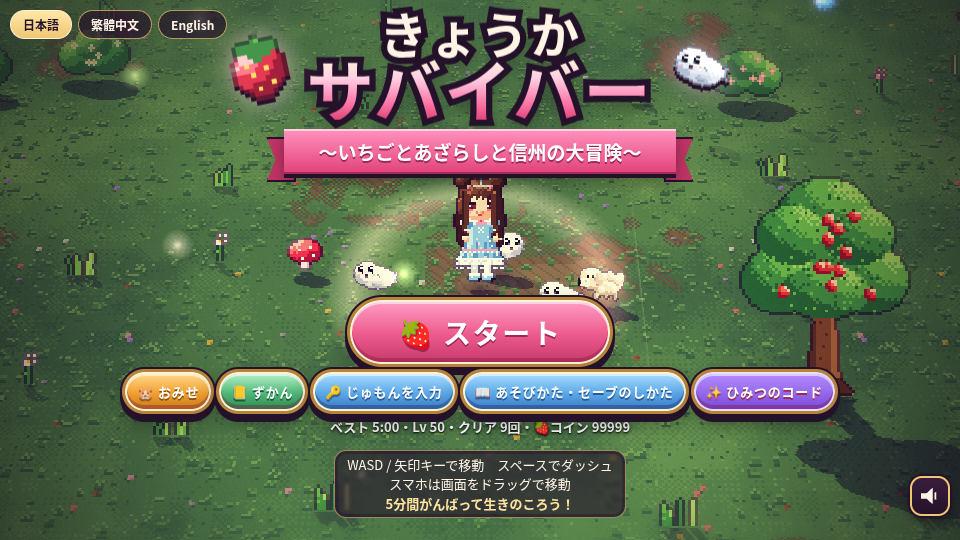
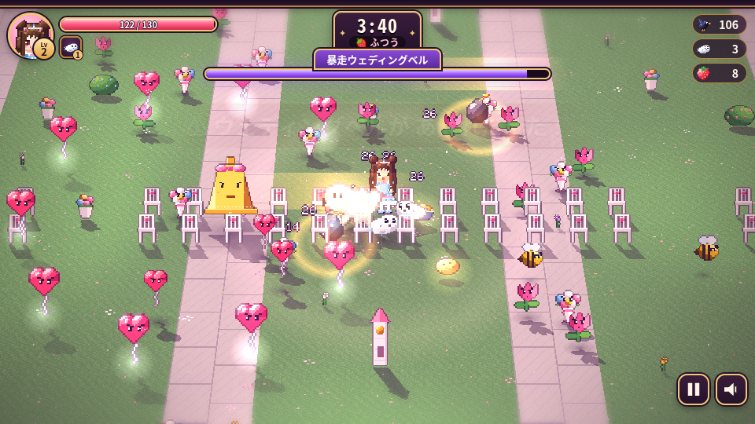

<div align="center">


# きょうかサバイバー 🍓🦭 (Kyoka Survivors)

**~ A Big Adventure with Strawberries, Seals and Shinshu ~**

[日本語](README.md) | [繁體中文](README.zh-TW.md) | **English**

**▶ Play: [https://kevin-nm.github.io/kyoka-survivor/](https://kevin-nm.github.io/kyoka-survivor/)**

 

</div>

> 粉絲自製的，與官方無關。（Fan-made, not official.）

## Contents
- [About](#about)
- [How to play](#how-to-play)
- [Features](#features)
- [Save codes](#save-codes)
- [Special move (キョンレンジャー大集合)](#special-move-キョンレンジャー大集合)
- [Mid-run save (resume code)](#mid-run-save-resume-code)
- [All-unlock code](#all-unlock-code)
- [Secret codes](#secret-codes)
- [Development](#development)
- [Credits / notes](#credits--notes)

## About

A small fan-made survivors-like browser game themed on 守屋亨香 (@kyoka_moriya).
Guide Kyon, fight with strawberries and seals, and survive for 5 minutes!

- One self-contained HTML file (~1 MB, three.js inlined) that works offline.
- 日本語 / 繁體中文 / English (switch on the title screen).
- Rendering: three.js with a tilted 2.5D camera, instanced billboard pixel sprites, projected silhouette shadows, and a custom post chain (bloom, tilt-shift, grading, vignette, grain).
- All art is procedural pixel art drawn in code (`src/art*.js`). All sound is synthesized with WebAudio (`src/audio.js`).

## How to play

1. Open [https://kevin-nm.github.io/kyoka-survivor/](https://kevin-nm.github.io/kyoka-survivor/) in a browser (or open `index.html` / `dist/index.html` directly). That's it: no install, no network.
2. Press Start → pick a character and a stage → pick a difficulty.
3. Survive 5 minutes to clear the stage.

| Action | Keyboard | Phone |
|---|---|---|
| Move | WASD / arrow keys | Drag on the screen |
| Dash | Space | DASH button |
| Pause / mute | P, Esc / M | ⏸ / 🔊 buttons |
| Pick a card | 1-3 | Tap |

## Features

- **13 characters**: Kyon, Odekake Kyon (first clear), Kyon Ranger (evolve the Henshin Beam), Dress Kyon (clear the Flower Chapel), Goth Kyon (clear on Hard or harder), DJ Kyon (Halloween DJ Night), Ama-Loli Kyon and Wa-Loli Kyon (Paris Collection Runway), Machi-musume Kyon (Yamagata Cherry Bus Tour), Station Master Kyon (Station Master for a Day), Guitar Kyon (Red) (千客万来 Clinic), Kumicho Kyon (亨香組 HQ) and 漆黒のブルーサファイア (collect 5 ハムナンバーカード).
- **19 stages**: Apple Orchard → Strawberry Fields → Sunset Racecourse → Inside the Cage → The Zoo → Snowy Shinshu → Night Stage → Flower Chapel → Chinatown → Halloween DJ Night → Paris Collection Runway → Ryogoku Ring → Miso Soup at Dawn → Yamagata Cherry Bus Tour → Station Master for a Day → 千客万来 Clinic → きょうみお Okinawa Mission → 亨香組 HQ → **Road to the 20th ∞**. Each clear opens the next one, and every stage has its own scenery, foes, boss, music and gimmick (a runway that turns to night, a shogi king guarded by gold and silver, a locomotive charging down a rail, twin shisa with timed missions, the 鉄の掟 scroll, and more). The stage list is paged, 10 per page.
- **Road to the 20th ∞**: an encore that never ends. The era (a set of stages) changes every 3 minutes (six eras make an 18-minute lap) and each lap gets harder. The HUD career counter runs from 2007 and turns to ∞ after 2027, when the first lap ends (18:00). Game over reads 「本日の公演は終了しました」. Surviving 5 minutes counts as a clear.
- **4 difficulties**: 🌱 Easy / 🍓 Normal / 🔥 Hard / ⚡ Geki-muzu. Records are kept per difficulty (the ★ colour shows the hardest level cleared; 👑 = Geki-muzu).
- **21 weapons with evolutions**: any weapon at Lv5 (MAX) offers its evolution card at the next level-up. The 7 new weapons (Turntable, Lace Parasol, きょん式ハートロック, Shogi Shuriken, Station Master's Whistle, Syringe Rocket, チャカ⇄ダンビラ) join the level-up pool on their own stage, or anywhere once that stage is cleared.
- **Food**: oyaki, fried shrimp, yakiniku (a treat for Dad too!), strawberry cake (full HP + shield), roast beef, steak, nikujaga, buri daikon, tapioca milk tea (speed boost), a Taiwanese sandwich, mala soup (fire aura), animal buns, pan-fried soup dumplings (hot!), and giant fried chicken. The new stages drop crêpes, choc muffins, waffles, miso soup, cherries, rice crackers, Okinawa soba, grilled ray fin, sweet potatoes and more, plus special items such as Bunny Ears, a Champion Belt, a Townsgirl Hairpin, a Station Cap, Medicine, a Nurse Cap, strawberry milk shaved ice, キョウカのエモノ and the 熱唱タオル.
- **Boss treasure**: the Flower Chapel boss drops a cake shaped like a pro-wrestling ring.
- **Strawberry Coins and a shop** with permanent upgrades (you can even borrow). The shop has three tabs: "⭐ Basics", "🎀 きょん goods" (きょんカフェ = slow HP regen, 熱唱タオル = less boss damage, ハムナンバーカード = a level-up at the start) and "📈 Keep growing" (damage, HP, speed, pickup range, coins and XP; buy them again and again, each level a little pricier).
- **Kyon encyclopedia (70 pages), 64 achievements, and an endless mode.**
- **Grow forever**: once every weapon and item is maxed (or the slots are full), level-ups offer stacking boosts instead of food cards: Damage +3% (compounding), Max HP +5, Cooldowns −1%, Area +3% and HP regen +0.25/s.
- **Endless mode**: keep going after the 5-minute clear. Foes get stronger every minute and elite hordes come more and more often; shooters and chargers make standing still a losing plan. Bosses come every 2 minutes at first, down to every 45 seconds as the threat rises, sometimes two at once (a red ring warns before each big attack). You get one more weapon slot at 5:00, 6:30, 8:00 and 9:30 (up to 10), then one more every minute until every weapon you can get in that run fits (21 with everything unlocked, at 20:30). Shooters only fire while they are on screen, and new foes don't appear right in front of where you are running, so moving is the way to survive. On Geki-muzu the threat reaches Lv10 around 12:00. The HUD shows a threat level and your best endless time is kept.

<details>
<summary>Evolutions (14)</summary>

| Weapon | Evolution |
|---|---|
| Strawberry Shot | Strawberry Shower |
| Lariat | Giga Lariat |
| Henshin Beam | Final Explosion |
| Penlight | Sea of Penlights |
| Racehorse Rush | Grand Stampede |
| Seal Buddy | Seal Gathering |
| Calligraphy Brush | Unreadable Kanji |
| Drums | Drum Fever |
| Microphone | Encore Live |
| Apples | Apple Typhoon |
| Hamster Ball | Hamster Parade |
| Cheer Fan | Fan Whirlwind |
| Guitar | Gothic Rock Solo |
| Glowsticks | Mini Live |

</details>

<details>
<summary>Difficulty table</summary>

| | Foe HP | Damage | Speed | Foe count | Coins |
|---|---|---|---|---|---|
| 🌱 Easy | ×0.75 | ×0.6 | ×0.92 | ×0.8 | ×0.8 |
| 🍓 Normal | ×1.35 | ×1.25 | ×1.06 | ×1.2 | ×1 |
| 🔥 Hard | ×2 | ×1.7 | ×1.14 | ×1.45 | ×1.5 |
| ⚡ Geki-muzu | ×3.6 | ×2.6 | ×1.24 | ×1.9 | ×2.2 |

On Hard and Geki-muzu, foe HP and numbers ramp up over the first 2 minutes. From Normal up, gold elite foes sometimes appear.

</details>

## Save codes

- How the codes are built (layout, bit widths, checksum, versions, checks, storage keys): [docs/save-code.en.md](docs/save-code.en.md)
- Progress auto-saves to the browser (localStorage).
- The result and pause screens show a 104-character "password" code (復活の呪文-style, 26 groups of 4) with a Copy button. On another device, enter it from the title screen with "じゅもんを入力". Entering a code replaces your current save with exactly what the code holds (nothing is merged, so an older code can't be used to farm coins).
- The code holds coins, debt, shop upgrades (including stacking levels), achievements, secret codes used, the day ichigo was last used, the last difficulty, and for each stage its best time and kills (rounded to 5 s, up to 42:35, and 20 kills; only the time for the 10 new stages, so kills aren't shown there after a restore) plus the hardest difficulty cleared there. The browser's own save keeps exact records for each difficulty.
- Case, spaces, dashes and full-width characters are ignored. Older 12-, 24-, 44-, 52-, 60-, 84- and 92-character codes still work.
- Encoding (v8): 491 data bits + CRC-12, written in base-31 with `23456789ABCDEFGHJKMNPQRSTUVWXYZ` (no 0/O/1/I/L). Any single-character typo or swap of two neighbours is rejected.
- The full guide is in the game, under "あそびかた・セーブのしかた".

## Special move (キョンレンジャー大集合)

- Defeating foes fills the gauge at the bottom right (about once every 60–90 s). When it's full, a big "Special" button appears (above 衝刺 on phones; Q on a keyboard).
- Press it for a tokusatsu-style sequence (about 4.7 s; the game is frozen meanwhile and foes don't move): the screen dims and a cut-in slides in → キョンレッド, キョンブルー, キョンイエロー, キョングリーン and キョンピンク land one by one in a pillar of light → the five pose in front of a five-colour explosion → a five-colour beam sweeps the screen and clears the foes on it.
- From the second time on, tap the screen (Enter, Space or Q on a keyboard) to skip; the final beam still lands.
- Bosses take 10% of their max HP (capped at 5% in endless).
- Every character can use it; キョンレンジャー fills the gauge faster (about every 45–60 s). The gauge is kept in resume codes.

## Mid-run save (resume code)

- Pausing saves the current run in this browser (also every 10 seconds while playing, and when the tab closes).
- Next time you open the game it asks "Continue where you left off?". "Continue" picks the run back up; "Start over" ends that run (the coins it earned are banked then).
- "🔖 Resume code" on the pause menu shows a resume code of about 48 characters. Enter it with "🔖 Resume code" on the title screen to keep playing, even in another browser.
- Coins are banked once, when a run ends. A finished run's resume code no longer works, so coins can't be doubled.
- A resume code for a stage or character this save hasn't unlocked is refused (fine after the all-unlock code).
- If the run saved in this browser can't continue (for example, after restoring a save that hasn't unlocked its stage), it isn't deleted: the dialog says why and shows its code, with "Keep it" or "Discard". Only a run that is already over is removed silently.

## All-unlock code

Enter it with "じゅもんを入力" on the title screen and press OK. It opens all 13 characters and 19 stages (all counted as cleared on Geki-muzu), all 21 weapons, 64 achievements, 70 encyclopedia pages, endless mode, every shop upgrade (including the きょん goods and stacking upgrades), and 99999 Strawberry Coins.

`FR3V-E99E-PT5D-NY8R-RYCQ-4JJA-Y24V-UMP6-BGS4-HN6R-WBJ4-UCSJ-WRPR-C2KG-98AH-5HCZ-UY8P-QHM2-SUAP-TCYK-MC6Y-U2JW-FFDY-K7HT-D8VP-K6SE`

- It replaces your current save with the code's contents (every stage counts as a 5:00 clear). Secret codes stay unused, so you can still try them.
- The older 92-, 84-, 60-, 52- and 44-character all-unlock codes still work, but the new shop goods and stacking upgrades need a code of 92 characters or more.

## Secret codes

Type them into "✨ ひみつのコード" on the title screen (hiragana, katakana or romaji; any case; full-width is fine). Each works once per save, except `ichigo`, which works once per day (your device's calendar day). Entering it again the same day shows "Already used today! Come back tomorrow".

| Code | Effect |
|---|---|
| `ichigo` / いちご | +10000 Strawberry Coins (once a day) |
| `azarashi` / あざらし | All characters unlocked |
| `shinshu` / しんしゅう | All stages and endless mode unlocked |
| `hamuhamu` / はむはむ | Debt cleared |
| `hanpen` / はんぺん | Hanpen is always giant and stronger |
| `kyonkyon` / きょんきょん | Every weapon at MAX for the next run (once) |
| `zukan` / ずかん | Every encyclopedia page readable |
| `ohayau` / おはやう | Always start with 3 seals |

## Development

```sh
npm i                 # esbuild + three.js
node build.mjs        # bundles src/ into one dist/index.html, copied to ./index.html (favicon inlined as data URIs)
npm test              # unit tests for save codes and meta (shop, achievements, encyclopedia); docs/save-code tables match the source
```

Browser tests use headless Chrome through playwright-core (`cd test && npm i`). Screenshots go to `shots/` (gitignored).

| Command | What it checks |
|---|---|
| `node test/full.mjs` | Screenshots and a console-error check |
| `node test/phase1.mjs` … `phase6.mjs` | Shop, stages, bosses, evolutions, difficulty, Flower Chapel, Chinatown, the 10 new stages, and more |
| `node test/ui6.mjs` | Every new stage, character, weapon and encyclopedia page shows in the menus in all 3 languages |
| `node test/selinfo.mjs` | On phones, the select screen shows the chosen character's info under the grid, in all 3 languages, without clipping |
| `node test/restore.mjs` | Entering a code replaces the save (no coin farming), ichigo once a day, best times shown consistently |
| `node test/hudfit.mjs` | On phones (473, 390, 360 wide) and PC, 10–21 weapons + 5 items + every boost, the timer and two boss bars never overlap |
| `node test/lvcards.mjs` | Phone level-up cards: number, name, stars and NEW never collide |
| `node test/cine.mjs` | Special-move sequence: game frozen, foes cleared at the end, skippable the second time, capped sparks (key-frame shots at 390 and 960) |
| `node test/special.mjs` | Special move: gauge rate, button, on-screen foes cleared, capped boss damage, kept in resume codes |
| `node test/runsave.mjs` | Mid-run save: pause → resume code, reload → continue, a code can't be used twice, a locked or broken saved run is kept with its reason (keep / discard) |
| `node test/afk.mjs road geki` | Endless with a maxed build: standing still should fall around 8–10 min; `KITE=1` runs a simple kiting bot instead (aim: 15–20 min). One short scripted run each |
| `node test/save-ui.mjs` | Save and guide screens |
| `node test/textfit.mjs` | Text overflow on every screen in all 3 languages |
| `node test/evo-sweep.mjs` | Runs every evolution in-game |
| `node test/sim.mjs` / `sim.mjs diff [set=new]` | 5-minute auto-play balance runs |
| `node test/perf.mjs` | JS cost per frame with 100/400/600 foes |
| `node test/make-icon.mjs` | Re-renders `assets/icon*.png` from the game's pixel art |

Main source files: `src/main.js` (game), `src/render.js` (three.js), `src/art*.js` (pixel art), `src/audio.js` (sound), `src/save.js` (save codes), `src/meta.js` (shop, achievements, encyclopedia), `src/i18n.js` `src/text*.js` `src/ui-text.js` `src/guide.js` (text).

## Credits / notes

- 粉絲自製的，與官方無關。（Fan-made, not official.）
- The Kyon encyclopedia only uses things Kyon herself has shared publicly; it names no other people or shops.
- All art, sound and music are original to this project.
- three.js is MIT licensed (the notice is kept in the build).
