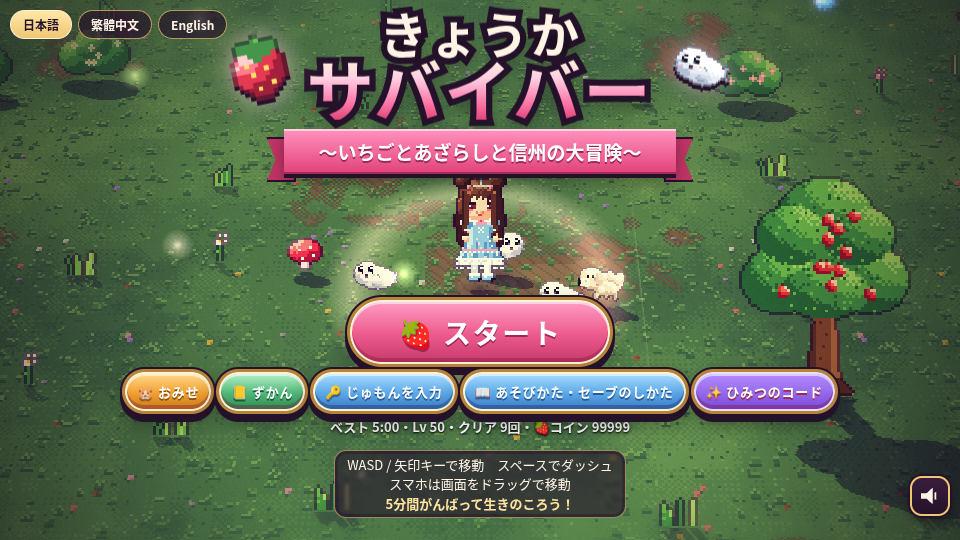
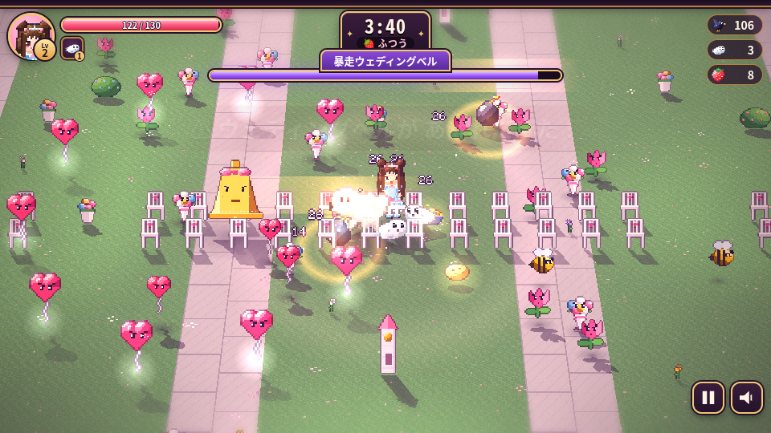

<div align="center">


# きょうかサバイバー 🍓🦭

**〜いちごとあざらしと信州の大冒険〜**

**日本語** | [繁體中文](README.zh-TW.md) | [English](README.en.md)

**▶ あそぶ：[https://kevin-nm.github.io/kyoka-survivor/](https://kevin-nm.github.io/kyoka-survivor/)**

バージョン v1.1.0（タイトル画面の 右下に バージョンと ビルド日が でます）

 

</div>

> 粉絲自製的，與官方無關。（Fan-made, not official.）

## もくじ
- [About](#about)
- [あそびかた](#あそびかた)
- [Features](#features)
- [セーブ（じゅもん）](#セーブじゅもん)
- [必殺技（キョンレンジャー大集合）](#必殺技キョンレンジャー大集合)
- [とちゅうセーブ（つづきコード）](#とちゅうセーブつづきコード)
- [ぜんぶ開放コード](#ぜんぶ開放コード)
- [ひみつのコード](#ひみつのコード)
- [Development](#development)
- [Credits / notes](#credits--notes)

## About

守屋亨香さん（@kyoka_moriya）を テーマに した、ファンメイドの ちいさな サバイバー系 ブラウザゲームです。
きょんを うごかして、いちごや あざらしで 5分間 いきのころう！

- 1つの HTML ファイル（約 1 MB、three.js 込み）で、オフラインでも うごきます。
- 日本語 / 繁體中文 / English（タイトル画面で きりかえ）。
- 絵は ぜんぶ コードで かいた ドット絵（`src/art*.js`）、音は WebAudio で つくっています（`src/audio.js`）。

## あそびかた

1. ブラウザで [https://kevin-nm.github.io/kyoka-survivor/](https://kevin-nm.github.io/kyoka-survivor/) を ひらく（または `index.html` / `dist/index.html` を そのまま ひらく）。それだけ！ インストールも ネットも いりません。
2. 「スタート」→ キャラクターと ステージを えらぶ → むずかしさを えらぶ。
3. 5分 いきのこれば クリア。

| そうさ | パソコン | スマホ |
|---|---|---|
| いどう | WASD / やじるしキー | 画面を ドラッグ |
| ダッシュ | Space | DASH ボタン |
| ポーズ / ミュート | P・Esc / M | ⏸ / 🔊 ボタン |
| カードを えらぶ | 1〜3 | タップ |

## Features

- **キャラクター 13人**：きょん、おでかけきょん（はじめて クリア）、キョンレンジャー（変身ビームを しんか）、ドレスきょん（花のチャペルを クリア）、ゴスロリきょん（むずかしい いじょうで クリア）、DJきょん（ハロウィンDJナイト）、甘ロリきょん・和ロリきょん（パリコレ・ランウェイ）、町娘きょん（山形さくらんぼバスツアー）、駅長きょん（一日駅長・山口駅）、ギターきょん（赤）（千客万来クリニック）、くみちょーきょん（亨香組 本部）、漆黒のブルーサファイア（ハムナンバーカードを 5まい あつめる）。
- **ステージ 19**：りんご畑 → いちご畑 → 夕焼けの競馬場 → ケージの中 → どうぶつえん → 雪の信州 → 夜のステージ → 花のチャペル → 中華街 → ハロウィンDJナイト → パリコレ・ランウェイ → 両国リング → 夜明けの味噌汁 → 山形さくらんぼバスツアー → 一日駅長・山口駅 → 千客万来クリニック → きょうみお沖縄ミッション → 亨香組 本部 → **20周年への道 ∞**。ひとつ クリアすると つぎが ひらきます。ステージごとに 景色・敵・ボス・曲・とくべつな しかけが ちがいます（よるに なる ランウェイ、金と銀に まもられた 王将、線路を はしる 機関車、2たいの シーサーと ミッション、鉄の掟の 巻物 など）。ステージえらびは 10こずつの ページです。
- **20周年への道 ∞**：おわらない アンコール。3分ごとに 時代（ステージの セット）が かわり（6つで 1周 18分）、1周ごとに つよく なります。HUD の「芸歴」は 2007 から すすみ、1周めの おわり（18:00）で 2027 を こえて ∞ に。ゲームオーバーは「本日の公演は終了しました」。5分 いきのこると クリア あつかい。
- **むずかしさ 4つ**：🌱 やさしい / 🍓 ふつう / 🔥 むずかしい / ⚡ ゲキムズ。記録は むずかしさ ごとに のこります（★ の 色 = クリアした いちばん むずかしい レベル、👑 = ゲキムズ）。
- **ぶき 21こ と しんか**：どの ぶきも Lv5（MAX）に なると、つぎの レベルアップで しんかカードが でます。あたらしい 7この ぶき（ターンテーブル・レースの日傘・きょん式ハートロック・将棋の駒手裏剣・駅長のホイッスル・ちゅうしゃロケット・チャカ⇄ダンビラ）は、その ステージで あそぶか クリアすると レベルアップに でます。
- **たべもの**：おやき、エビフライ、焼肉（お父さんにも ごちそう！）、いちごケーキ（HP ぜんかい＋むてき）、ローストビーフ、ステーキ、肉じゃが、ぶり大根、タピオカミルクティー（スピードアップ）、台湾サンドイッチ、麻辣スープ（ほのおの オーラ）、アニマルまん、焼き小籠包（あちちっ！）、大鶏排。あたらしい ステージでは クレープ・チョコマフィン・ワッフル・味噌汁・さくらんぼ・おせんべい・沖縄そば・炙りエイヒレ・おいも などと、うさ耳・チャンピオンベルト・町娘のかんざし・駅長帽・おくすり・ナースキャップ・いちごミルクかき氷・キョウカのエモノ・熱唱タオル などの とくべつな アイテムが でます。
- **ボスの たからばこ**：花のチャペルの ボスは プロレスの リングの かたちの「リングケーキ」を おとします。
- **いちごコインと おみせ**：コインで アップグレードを かえます（しゃっきんも できる）。おみせは「⭐ きほん」「🎀 きょんグッズ」（きょんカフェ＝HP かいふく、熱唱タオル＝ボスの ダメージ ダウン、ハムナンバーカード＝スタートで レベルアップ）「📈 どんどん強化」（こうげき・HP・はやさ・すいよせ・コイン・けいけんち。なんかいでも かえて、かうたびに すこし たかく なる）の 3つに わかれています。
- **きょん図鑑 70ページ・じっせき 64こ・むげんモード**。
- **ずっと つよくなれる**：ぶきと アイテムが ぜんぶ MAX（または スロット満タン）に なると、レベルアップで「こうげき +3%」「さいだいHP +5」「クールダウン -1%」「こうげき範囲 +3%」「HP じどうかいふく」などの かさねられる パワーアップが でます（たべものカードは でません）。
- **むげんモード**：5分 クリアの あと つづけると、敵は 1分ごとに どんどん つよく なり、つよい敵の むれも だんだん ふえます。とまっていると たおされる ように、たまを うつ敵や とっしんする敵も でます。ボスは さいしょ 2分ごと、きけん Lv が あがると 45びょうごとまで みじかく なり、2たい いっしょに くることも（ボスの おおわざの まえには 赤い わが でます）。ぶきスロットは 5:00・6:30・8:00・9:30 に 1こずつ ふえて 10こ、そのあとは 1分ごとに 1こずつ ふえて、その ゲームで とれる ぶきが ぜんぶ もてるように なります（ぜんぶ ひらいていれば 21こ、20:30）。むげんモードでは ぶきも アイテムも MAX（しんか）の あとも レベルが あがりつづけ（カードと HUD に「Lv 15 → 16」）、こうげきと はんいが すこしずつ ふえます（たまの かずは ふえないので スマホでも かるい まま）。たまを うつ敵は がめんの なかに いる ときだけ うち、あたらしい 敵は はしっている まえには でないので、うごく ほうが いきのこれます。HUD に「きけん Lv」（ゲキムズなら 12分ごろに Lv10）、記録に「∞ さいこう」が でます。

<details>
<summary>しんか いちらん（21）</summary>

| ぶき | しんか |
|---|---|
| いちごショット | いちごシャワー |
| ラリアット | ギガ・ラリアット |
| 変身ビーム | ファイナル爆破 |
| ペンライト | ペンライトの海 |
| 愛馬ダッシュ | 愛馬の大行進 |
| あざらし | あざらし大集合 |
| 書道の筆 | 読めない漢字 |
| ドラム | ドンドコ・フィーバー |
| マイク | アンコール・ライブ |
| りんご | りんご台風 |
| ハムスターボール | ハムハム大行進 |
| おうえんうちわ | うちわ大旋風 |
| ギター | ゴシックロック・ソロ |
| サイリウム | ミニライブ |
| ターンテーブル | ハロウィンDJセット |
| レースの日傘 | パリコレの日傘 |
| きょん式ハートロック | ギュッとハートロック |
| 将棋の駒手裏剣 | 王手！ |
| 駅長のホイッスル | 発車ベル |
| ちゅうしゃロケット | 千客万来 |
| チャカ⇄ダンビラ | くみちょーの本気 |

</details>

<details>
<summary>むずかしさの ちがい</summary>

| | 敵の HP | ダメージ | はやさ | 敵の数 | いちごコイン |
|---|---|---|---|---|---|
| 🌱 やさしい | ×0.75 | ×0.6 | ×0.92 | ×0.8 | ×0.8 |
| 🍓 ふつう | ×1.35 | ×1.25 | ×1.06 | ×1.2 | ×1 |
| 🔥 むずかしい | ×2 | ×1.7 | ×1.14 | ×1.45 | ×1.5 |
| ⚡ ゲキムズ | ×3.6 | ×2.6 | ×1.24 | ×1.9 | ×2.2 |

むずかしい と ゲキムズ では、敵の HP と 数が さいしょの 2分で だんだん 上がります。ふつう いじょうでは ときどき 金色の「つよい」敵も でます。

</details>

## セーブ（じゅもん）

- じゅもんの しくみ（ならびかた・ビット数・チェックサム・版・チェック・保存する キー）：[docs/save-code.md](docs/save-code.md)
- しんこうは ブラウザに じどうで セーブされます。
- 結果画面と ポーズ画面に、104もじの「じゅもん」（4もじ × 26グループ）と コピーボタンが でます。べつの 端末では タイトル画面の「じゅもんを入力」で いれれば もとに もどります。いれると いまの セーブは じゅもんの ないように そっくり おきかわります（まぜたり しないので、まえの じゅもんで コインを ふやす ことは できません）。
- じゅもんには コイン・しゃっきん・おみせ（どんどん強化の レベルも）・じっせき・つかった ひみつのコード・いちごを さいごに つかった 日・さいごの むずかしさ・ステージごとの ベスト記録（時間は 5びょう ずつ まるめで さいだい 42:35、たおした数は 20 ずつ まるめ。あたらしい 10ステージは 時間だけ なので、そこでは たおした数を ださない）と クリアした いちばん むずかしい レベルが はいっています。
- 小文字・スペース・「-」・全角は あっても なくても OK。まえの 12・24・44・52・60・84・92もじの じゅもんも そのまま つかえます。
- しくみ（v8）：491 bit の データ ＋ CRC-12 を、`23456789ABCDEFGHJKMNPQRSTUVWXYZ`（0/O/1/I/L なし）の 31進数で かいています。1もじの まちがいや いれかわりは ちゃんと はじかれます。
- くわしい せつめいは ゲームの なかの「あそびかた・セーブのしかた」に あります。

## 必殺技（キョンレンジャー大集合）

- 敵を たおすと 右下の ゲージが たまる（だいたい 60〜90びょうに 1かい）。たまると 大きな「必殺技」ボタンが でるよ（スマホは 衝刺の うえ、PC は Q キー）。
- おすと 特撮みたいな えんしゅつ（やく 4.7びょう。そのあいだ ゲームは とまって、敵も うごかない）：画面が くらく なって カットイン → キョンレッド・キョンブルー・キョンイエロー・キョングリーン・キョンピンクが 1人ずつ 光の はしらで とうじょう → 5人で ポーズして 5色の 大ばくはつ → 5色の ビームで 画面の 敵を いっきに たおす。
- 2かいめ からは 画面を タップ（PC は Enter・スペース・Q）で スキップ できる（とどめの ビームは ちゃんと でる）。
- ボスには さいだいHPの 10%（むげんモードは 5% まで）。
- どの キャラでも つかえる。キョンレンジャーは ゲージが はやく たまる（だいたい 45〜60びょう）。ゲージは つづきコードにも はいるよ。

## とちゅうセーブ（つづきコード）

- ポーズすると、いまの ゲームが このブラウザに じどうで セーブされるよ（あそんでいる あいだも 10びょうごと、タブを とじたときも）。
- つぎに ひらくと「前回の続きから遊ぶ？」と きくよ。「つづきから」で つづき、「最初から」で その ゲームは おしまい（それまでの コインは そこで もらえる）。
- ポーズの「🔖 つづきコード」で、48もじくらいの つづきコードが でるよ。タイトルの「🔖 つづきコード」に いれると、べつの ブラウザでも つづきから あそべる。
- コインは ゲームが おわったときに 1かいだけ もらえる。おわった ゲームの つづきコードは もう つかえないから、コインが ふえることは ないよ。
- まだ ひらいていない ステージや キャラの つづきコードは つかえない（ぜんぶ開放コードを いれていれば OK）。
- ブラウザに のこった ゲームが いま つづけられない とき（たとえば まだ ひらいていない ステージの セーブに じゅもんで もどした とき）も けさないよ。りゆうと コードを みせて「のこしておく」か「すてる」を えらべる。もう おわった ゲームだけは だまって けすよ。

## ぜんぶ開放コード

タイトル画面の「じゅもんを入力」に いれて「OK」。キャラクター13人・ステージ19（ぜんぶ ゲキムズまで クリア あつかい）・ぶき21こ・じっせき64こ・ずかん70ページ・むげんモード・おみせの アップグレード ぜんぶ（きょんグッズ・どんどん強化も MAX）と、いちごコイン 99999 が つかえるように なります。

<!--ALLCODE-->`FR3V-E99E-PT5D-NY8R-RYCQ-4JJA-Y24V-UMP6-BGS4-HN6R-WBJ4-UCSJ-WRPR-C2KG-98AH-5HCZ-UY8P-QHM2-SUAP-TCYK-MC6Y-U2JW-FFDY-K7HT-D8VP-K6SE`

- いまの セーブは この コードの ないように おきかわります（記録は ぜんぶ 5:00 クリア あつかいに なります）。ひみつのコードは まだ つかっていない あつかいです。
- まえの 92・84・60・52・44もじの ぜんぶ開放コードも つかえますが、おみせの あたらしい しなもの（きょんグッズ・どんどん強化）は 92もじ いじょうの コードで ひらいてね。

## ひみつのコード

タイトル画面の「✨ ひみつのコード」に いれてね（ひらがな・カタカナ・ローマじ、大文字・小文字・全角 どれでも OK）。1つの セーブで それぞれ 1回だけ つかえます。`ichigo` だけは 1日1回（たんまつの カレンダーの 日づけ）。おなじ 日に もういちど いれると「今日はもう使ったよ！また明日ね」と でます。

| コード | こうか |
|---|---|
| `ichigo` / いちご | いちごコイン +10000（1日1回） |
| `azarashi` / あざらし | キャラクター ぜんいん つかえる |
| `shinshu` / しんしゅう | ステージ ぜんぶ と むげんモードが あそべる |
| `hamuhamu` / はむはむ | しゃっきんが ゼロに |
| `hanpen` / はんぺん | はんぺんが ずっと でっかく つよく なる |
| `kyonkyon` / きょんきょん | つぎの 1回だけ ぶき ぜんぶ MAX |
| `zukan` / ずかん | ずかんが ぜんぶ よめる |
| `ohayau` / おはやう | いつも あざらし 3びきで スタート |

## Development

```sh
npm i                 # esbuild + three.js
node build.mjs        # src/ → dist/index.html と ./index.html（おなじ 1ファイル、favicon も data URI で うめこみ）
npm test              # セーブ・つづきコード（v3 の コードも よめるか）・メタ（おみせ・じっせき・図鑑）の 単体テスト、docs/save-code の 表が ソースと あっているか
```

ブラウザテストは headless Chrome（playwright-core、`cd test && npm i`）。スクリーンショットは `shots/` に でます（git には いれません）。

| コマンド | ないよう |
|---|---|
| `node test/full.mjs` | スクリーンショット と コンソールエラーの チェック |
| `node test/phase1.mjs` 〜 `phase6.mjs` | おみせ・ステージ・ボス・しんか・むずかしさ・花のチャペル・中華街・あたらしい 10ステージ など |
| `node test/ui6.mjs` | あたらしい ステージ・キャラ・ぶき・図鑑が 3言語の メニューに ぜんぶ でるか |
| `node test/selinfo.mjs` | スマホの せんたく画面で、えらんだ キャラの せつめいが 3言語とも きれずに でるか |
| `node test/restore.mjs` | じゅもんを いれると セーブが そっくり おきかわる（コインを ふやせない）・いちごは 1日1回・ベスト記録の ひょうじ |
| `node test/hudfit.mjs` | スマホ（473・390・360）と PC で ぶき10〜21こ＋アイテム5こ＋パワーアップ ぜんぶ・タイマー・ボス2たいの ゲージが かさならないか |
| `node test/lvcards.mjs` | スマホの レベルアップ カード：ばんごう・なまえ・ほし・NEW が かさならないか |
| `node test/cine.mjs` | 必殺技の えんしゅつ：ゲームが とまる・さいごに 敵が きえる・2かいめは スキップ・つぶつぶの 上限（390・960 の キー画面） |
| `node test/special.mjs` | 必殺技：ゲージの はやさ・ボタン・画面の 敵が きえる・ボスは わりあいで 上限つき・つづきコード |
| `node test/runsave.mjs` | とちゅうセーブ：ポーズ→つづきコード、リロード→つづきから、2かいめは つかえない、つかえない セーブは りゆうつきで のこる（のこす／すてる） |
| `node test/afk.mjs road geki` | むげん（さいきょう ビルド）：とまったままだと 8〜10分ごろ たおれるか。`KITE=1` で にげまわる ボット（めやす 15〜20分）。どちらも 1かいだけの みじかい チェック |
| `node test/save-ui.mjs` | セーブと ガイドの 画面 |
| `node test/textfit.mjs` | ぜんぶの 画面 × 3言語で 文字の はみだしチェック |
| `node test/evo-sweep.mjs` | ぜんぶの しんかを じっさいに うごかす |
| `node test/sim.mjs` / `sim.mjs diff [set=new]` | 5分の オートプレイで バランス チェック |
| `node test/perf.mjs` | 敵 100/400/600 体での 1フレームの コスト |
| `node test/make-icon.mjs` | `assets/icon*.png` を ゲームの ドット絵から つくりなおす |

ソースの おもな ファイル：`src/main.js`（ゲーム）、`src/render.js`（three.js）、`src/art*.js`（ドット絵）、`src/audio.js`（音）、`src/save.js`（じゅもん）、`src/meta.js`（おみせ・じっせき・図鑑）、`src/i18n.js` `src/text*.js` `src/ui-text.js` `src/guide.js`（テキスト）。

## Credits / notes

- 粉絲自製的，與官方無關。（Fan-made, not official.）
- きょん図鑑は きょん本人の 公開されている はなしだけを もとに しています。ほかの人や お店の 名前は いれていません。
- 絵・音・曲は ぜんぶ この プロジェクトの オリジナルです。
- three.js は MIT License（ビルドに ライセンス表記を のこしています）。
