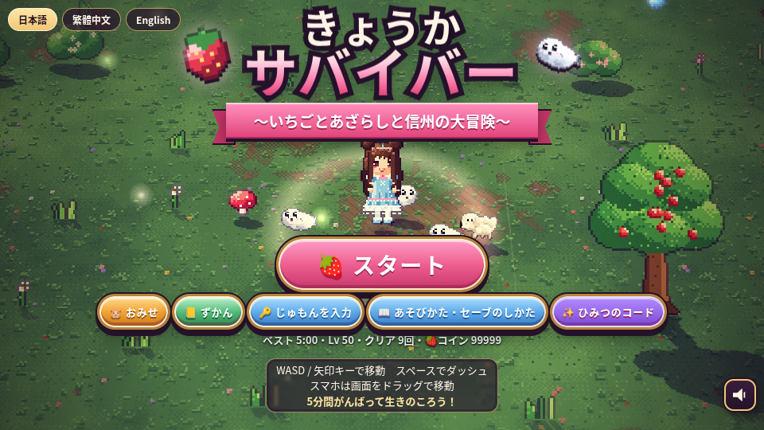
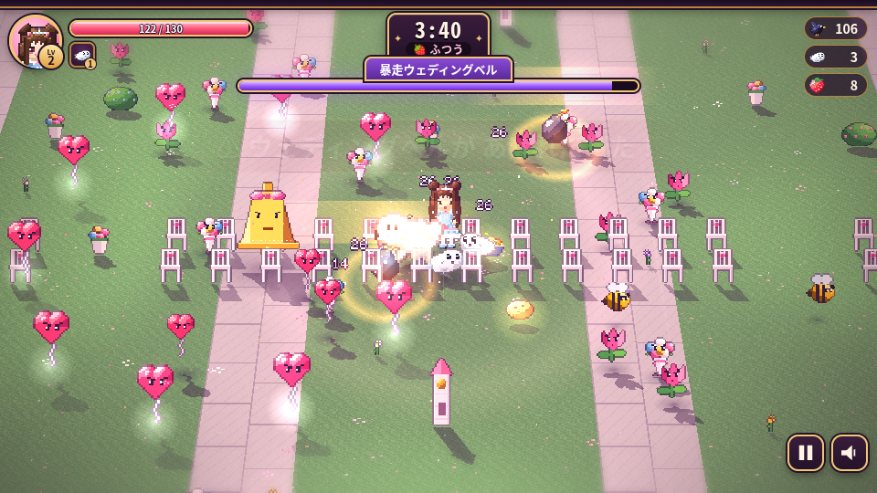

<div align="center">


# きょうかサバイバー 🍓🦭

**〜草莓、海豹與信州大冒險〜**

[日本語](README.md) | **繁體中文** | [English](README.en.md)

**▶ 開始玩：[https://kevin-nm.github.io/kyoka-survivor/](https://kevin-nm.github.io/kyoka-survivor/)**

 

</div>

> 粉絲自製的，與官方無關。（Fan-made, not official.）

## 目錄
- [About 簡介](#about-簡介)
- [怎麼玩](#怎麼玩)
- [Features 特色](#features-特色)
- [存檔咒語](#存檔咒語)
- [必殺技（キョンレンジャー大集合）](#必殺技キョンレンジャー大集合)
- [中途存檔（續玩碼）](#中途存檔續玩碼)
- [全解鎖咒語](#全解鎖咒語)
- [秘密密碼](#秘密密碼)
- [Development 開發](#development-開發)
- [Credits / 備註](#credits--備註)

## About 簡介

以守屋亨香（@kyoka_moriya）為主題、粉絲自製的小型「倖存者」類瀏覽器遊戲。
操作きょん，用草莓和海豹撐過 5 分鐘！

- 只有一個 HTML 檔（約 1 MB，內含 three.js），離線也能玩。
- 日本語／繁體中文／English（在標題畫面切換）。
- 所有圖都是用程式畫的像素畫（`src/art*.js`），聲音用 WebAudio 合成（`src/audio.js`）。

## 怎麼玩

1. 用瀏覽器打開 [https://kevin-nm.github.io/kyoka-survivor/](https://kevin-nm.github.io/kyoka-survivor/)（或直接打開 `index.html`／`dist/index.html`）。就這樣！不用安裝，也不用連網。
2. 按「スタート」→ 選角色和關卡 → 選難度。
3. 撐過 5 分鐘就過關。

| 操作 | 電腦 | 手機 |
|---|---|---|
| 移動 | WASD／方向鍵 | 拖曳畫面 |
| 衝刺 | 空白鍵 | DASH 按鈕 |
| 暫停／靜音 | P、Esc／M | ⏸／🔊 按鈕 |
| 選卡片 | 1〜3 | 點一下 |

## Features 特色

- **13 個角色**：きょん、おでかけきょん（第一次過關）、キョンレンジャー（進化變身光束）、ドレスきょん（通關花之教堂）、ゴスロリきょん（用「困難」以上難度過關）、DJきょん（萬聖節DJ之夜）、甘ロリきょん／和ロリきょん（巴黎時裝週伸展台）、町娘きょん（山形櫻桃巴士之旅）、駅長きょん（一日站長：山口站）、ギターきょん（紅）（千客万来診所）、くみちょーきょん（亨香組 本部）、漆黒のブルーサファイア（集滿 5 張ハムナンバーカード）。角色名稱保留日文原名。
- **19 個關卡**：蘋果園 → 草莓田 → 夕陽賽馬場 → 籠子裡 → 動物園 → 雪之信州 → 夜晚舞台 → 花之教堂 → 中華街 → 萬聖節DJ之夜 → 巴黎時裝週伸展台 → 兩國擂台 → 黎明的味噌湯 → 山形櫻桃巴士之旅 → 一日站長：山口站 → 千客万来診所 → きょうみお沖繩任務 → 亨香組 本部 → **通往20週年之路 ∞**。過一關就開放下一關，每關的場景、敵人、Boss、音樂和特殊機關都不一樣（會變成夜晚的伸展台、金將銀將守護的王將、沿著鐵軌衝刺的火車、兩隻風獅爺加限時任務、鉄の掟卷軸等）。關卡選單每頁 10 關。
- **通往20週年之路 ∞**：沒有結束的安可。每 3 分鐘換一個時代（一組關卡，6 個時代一圈共 18 分鐘），每繞一圈都更難。畫面上的「芸歷」從 2007 年開始前進，第一圈結束時（18:00）超過 2027 變成 ∞。遊戲結束時顯示「本日の公演は終了しました」。撐過 5 分鐘就算過關。
- **4 種難度**：🌱 簡單／🍓 普通／🔥 困難／⚡ 超級難。每個難度的紀錄分開保存（★ 的顏色＝過關的最高難度，👑＝超級難）。
- **21 種武器與進化**：任何武器升到 Lv5（滿級），下一次升級就會出現進化卡。7 種新武器（轉盤、蕾絲陽傘、きょん式ハートロック、將棋棋子手裏劍、站長哨子、針筒火箭、チャカ⇄ダンビラ）要在對應關卡遊玩或過關後才會出現在升級選項。
- **食物**：おやき、炸蝦、燒肉（也請爸爸吃！）、草莓蛋糕（HP 全回＋無敵）、烤牛肉、牛排、馬鈴薯燉肉、鰤魚燉蘿蔔、珍珠奶茶（加速）、台式三明治、麻辣湯（火焰光環）、動物造型包子、煎小籠包（好燙！）、大雞排。新關卡還會掉落可麗餅、巧克力瑪芬、鬆餅、味噌湯、櫻桃、仙貝、沖繩麵、炙烤魟魚鰭、地瓜等，以及兔耳、冠軍腰帶、町娘髮簪、站長帽、藥、護士帽、草莓牛奶刨冰、キョウカのエモノ、熱唱タオル等特殊道具。
- **Boss 寶物**：花之教堂的 Boss 會掉落職業摔角擂台造型的「擂台蛋糕」。
- **草莓幣與商店**：用草莓幣買永久升級（也可以借錢）。商店分成「⭐ 基本」「🎀 きょん周邊」（きょんカフェ＝慢慢回血、熱唱タオル＝Boss 傷害降低、ハムナンバーカード＝開場多升級一次）和「📈 無限強化」（攻擊、HP、移動速度、吸取範圍、草莓幣、經驗值；可以一直買，每次會貴一點）三類。
- **きょん圖鑑 70 頁、成就 64 個、無盡模式**。
- **可以一直變強**：武器和道具全部滿級（或欄位已滿）後，升級會出現「攻擊 +3%」「最大 HP +5」「冷卻 -1%」「攻擊範圍 +3%」「每秒回復 HP」等可疊加的強化（不會只剩食物卡）。
- **無盡模式**：撐過 5 分鐘後繼續玩，敵人每分鐘都會變強，強敵大軍也越來越常來；還會出現會射擊和會衝撞的敵人，站著不動就會被打倒。Boss 一開始每 2 分鐘一隻，危險 Lv 越高間隔越短（最短 45 秒），有時兩隻一起來（大招前會先出現紅色圈圈預告）。武器欄位在 5:00、6:30、8:00、9:30 各加 1 格到 10 格，之後每 1 分鐘再加 1 格，直到這一場拿得到的武器全部都放得下（全部解鎖的話是 21 格，在 20:30）。會射擊的敵人只在畫面內才開火，新敵人也不會出現在你正前方的路上，所以移動才是活下去的方法。超級難大約 12 分鐘到危險 Lv10。畫面上會顯示「危險 Lv」，紀錄會留下「∞ 最佳」時間。

<details>
<summary>進化一覽（14）</summary>

| 武器 | 進化 |
|---|---|
| 草莓射擊 | 草莓雨 |
| 金臂勾 | 超級金臂勾 |
| 變身光束 | 最終爆破 |
| 螢光棒 | 螢光棒之海 |
| 愛馬衝刺 | 愛馬大遊行 |
| 海豹 | 海豹大集合 |
| 書道之筆 | 讀不出來的漢字 |
| 爵士鼓 | 咚咚狂熱 |
| 麥克風 | 安可演唱會 |
| 蘋果 | 蘋果颱風 |
| 倉鼠滾球 | 倉鼠大遊行 |
| 應援扇 | 應援扇大旋風 |
| 吉他 | 哥德搖滾獨奏 |
| 發光棒 | 迷你演唱會 |

</details>

<details>
<summary>難度差異</summary>

| | 敵人 HP | 傷害 | 速度 | 敵人數量 | 草莓幣 |
|---|---|---|---|---|---|
| 🌱 簡單 | ×0.75 | ×0.6 | ×0.92 | ×0.8 | ×0.8 |
| 🍓 普通 | ×1.35 | ×1.25 | ×1.06 | ×1.2 | ×1 |
| 🔥 困難 | ×2 | ×1.7 | ×1.14 | ×1.45 | ×1.5 |
| ⚡ 超級難 | ×3.6 | ×2.6 | ×1.24 | ×1.9 | ×2.2 |

困難和超級難的敵人 HP 與數量會在前 2 分鐘逐漸增加。普通以上偶爾會出現金色的強敵。

</details>

## 存檔咒語

- 咒語的運作方式（欄位排列、位元數、校驗碼、版本、檢查、儲存的鍵）：[docs/save-code.zh-TW.md](docs/save-code.zh-TW.md)
- 進度會自動存在瀏覽器裡。
- 結算畫面和暫停畫面會顯示一串 104 個字的「咒語」（4 個字一組，共 26 組）和複製按鈕。換裝置時，在標題畫面按「じゅもんを入力」輸入就能還原。輸入後，目前的存檔會整個換成咒語裡的內容（不會合併，所以不能用舊咒語刷草莓幣）。
- 咒語裡存了草莓幣、欠債、商店升級（含無限強化的等級）、成就、用過的秘密密碼、最後一次用いちご的日期、上次的難度，以及每關的最佳紀錄（時間以 5 秒為單位、最多 42:35，擊倒數以 20 隻為單位；新的 10 關只存時間，所以那幾關不顯示擊倒數）和最高過關難度。
- 大小寫、空格、「-」、全形都沒關係。以前 12、24、44、52、60、84、92 個字的咒語也還能直接用。
- 原理（v8）：491 位元資料＋CRC-12，用 `23456789ABCDEFGHJKMNPQRSTUVWXYZ`（沒有 0/O/1/I/L）寫成 31 進位。打錯一個字或兩個字對調都會被擋下來。
- 詳細說明請看遊戲內的「あそびかた・セーブのしかた」。

## 必殺技（キョンレンジャー大集合）

- 打倒敵人會累積右下角的能量（大約每 60～90 秒一次）。集滿後會出現大大的「必殺技」按鈕（手機在衝刺鍵上方，電腦按 Q）。
- 按下去會播放特攝風格的演出（約 4.7 秒，期間遊戲暫停、敵人不會動）：畫面變暗、出現切入畫面 → キョンレッド、キョンブルー、キョンイエロー、キョングリーン、キョンピンク依序隨光柱登場 → 五人一起擺姿勢、背後五色大爆炸 → 五色光束掃過，一口氣打倒畫面上的敵人。
- 第二次起可以點畫面（電腦按 Enter、空白鍵或 Q）跳過，最後的光束一樣會發動。
- 對 Boss 造成最大 HP 的 10%（無盡模式最多 5%）。
- 所有角色都能用；キョンレンジャー集氣比較快（大約 45～60 秒）。能量也會存進續玩碼。

## 中途存檔（續玩碼）

- 暫停時會把目前這一場自動存進這個瀏覽器（遊玩中每 10 秒、關掉分頁時也會存）。
- 下次打開時會問「要從上次的進度繼續玩嗎？」。選「繼續玩」就接著玩；選「從頭開始」那一場就結束（到那時為止的草莓幣會在這時入帳）。
- 暫停畫面的「🔖 續玩碼」會顯示一組約 48 字的續玩碼。在標題畫面的「🔖 續玩碼」輸入，換一個瀏覽器也能接著玩。
- 草莓幣只在一場結束時入帳一次。已經結束的那一場，續玩碼就不能再用，所以不會重複拿到幣。
- 用到還沒解鎖的關卡或角色的續玩碼會被拒絕（輸入過全解鎖咒語就可以）。
- 如果瀏覽器裡存的那一場現在沒辦法繼續（例如用咒語換回還沒解鎖那一關的存檔），也不會被刪掉：畫面會說明原因並顯示那組碼，可以選「先保留」或「捨棄」。只有已經結束的場次會直接刪掉。

## 全解鎖咒語

在標題畫面按「輸入咒語」（じゅもんを入力），輸入下面的咒語再按「OK」。13 個角色、19 個關卡（全部算「超級難」過關）、21 種武器、64 個成就、70 頁圖鑑、無盡模式、商店所有升級（含きょん周邊和無限強化）全部解鎖，還有 99999 草莓幣。

`FR3V-E99E-PT5D-NY8R-RYCQ-4JJA-Y24V-UMP6-BGS4-HN6R-WBJ4-UCSJ-WRPR-C2KG-98AH-5HCZ-UY8P-QHM2-SUAP-TCYK-MC6Y-U2JW-FFDY-K7HT-D8VP-K6SE`

- 目前的存檔會換成這組咒語的內容（每關紀錄都算 5:00 過關）。秘密密碼還沒被用過，之後可以再試。
- 以前 92、84、60、52、44 個字的全解鎖咒語也還能用，但商店的新商品（きょん周邊、無限強化）要用 92 個字以上的咒語。

## 秘密密碼

在標題畫面按「✨ ひみつのコード」輸入（平假名、片假名、羅馬拼音、大小寫、全形都可以）。每個存檔每個密碼只能用一次。只有 `ichigo` 是每天一次（以裝置的日曆日期為準），同一天再輸入會顯示「今天已經用過了！明天再來喔」。

| 密碼 | 效果 |
|---|---|
| `ichigo`／いちご | 草莓幣 +10000（每天一次） |
| `azarashi`／あざらし | 所有角色解鎖 |
| `shinshu`／しんしゅう | 所有關卡和無盡模式解鎖 |
| `hamuhamu`／はむはむ | 欠債歸零 |
| `hanpen`／はんぺん | はんぺん永遠變超大、變更強 |
| `kyonkyon`／きょんきょん | 下一場所有武器 MAX（一次） |
| `zukan`／ずかん | 圖鑑全部可以看 |
| `ohayau`／おはやう | 每場一開始就有 3 隻海豹 |

## Development 開發

```sh
npm i                 # esbuild + three.js
node build.mjs        # src/ → dist/index.html 和 ./index.html（同一個單一檔案，favicon 也以 data URI 內嵌）
npm test              # 存檔與 meta（商店、成就、圖鑑）單元測試；docs/save-code 的表格和原始碼一致
```

瀏覽器測試使用 headless Chrome（playwright-core，`cd test && npm i`），截圖輸出到 `shots/`（不納入 git）。

| 指令 | 內容 |
|---|---|
| `node test/full.mjs` | 截圖與主控台錯誤檢查 |
| `node test/phase1.mjs`〜`phase6.mjs` | 商店、關卡、Boss、進化、難度、花之教堂、中華街、新的 10 關等 |
| `node test/ui6.mjs` | 新關卡、角色、武器、圖鑑是否在 3 種語言的選單裡完整出現 |
| `node test/selinfo.mjs` | 手機版選角畫面下方是否顯示所選角色的說明（3 種語言、不被裁切） |
| `node test/restore.mjs` | 輸入咒語會整個換掉存檔（不能刷草莓幣）、いちご每天一次、最佳紀錄顯示一致 |
| `node test/hudfit.mjs` | 手機（473、390、360 寬）和 PC 上 10～21 武器＋5 道具＋所有強化、計時器、2 隻 Boss 的血條互不重疊 |
| `node test/lvcards.mjs` | 手機升級卡片：編號、名稱、星星、NEW 互不重疊 |
| `node test/cine.mjs` | 必殺技演出：遊戲暫停、最後清掉敵人、第二次可跳過、粒子有上限（390 和 960 的關鍵畫面截圖） |
| `node test/special.mjs` | 必殺技：集氣速度、按鈕、清掉畫面上的敵人、Boss 傷害有上限、續玩碼保留能量 |
| `node test/runsave.mjs` | 中途存檔：暫停→續玩碼、重新整理→繼續玩、同一組碼不能用兩次、未解鎖或壞掉的進度會保留並顯示原因（保留／捨棄） |
| `node test/afk.mjs road geki` | 無盡（滿配）：站著不動約 8–10 分鐘倒下；`KITE=1` 改跑簡單的走位機器人（目標 15–20 分鐘）。各只跑一次的短檢查 |
| `node test/save-ui.mjs` | 存檔與說明畫面 |
| `node test/textfit.mjs` | 所有畫面 × 3 種語言的文字溢出檢查 |
| `node test/evo-sweep.mjs` | 實際跑過每一種進化 |
| `node test/sim.mjs`／`sim.mjs diff [set=new]` | 5 分鐘自動遊玩的平衡檢查 |
| `node test/perf.mjs` | 100/400/600 隻敵人時每幀的成本 |
| `node test/make-icon.mjs` | 用遊戲的像素畫重新產生 `assets/icon*.png` |

主要原始碼：`src/main.js`（遊戲）、`src/render.js`（three.js）、`src/art*.js`（像素畫）、`src/audio.js`（聲音）、`src/save.js`（咒語）、`src/meta.js`（商店、成就、圖鑑）、`src/i18n.js` `src/text*.js` `src/ui-text.js` `src/guide.js`（文字）。

## Credits / 備註

- 粉絲自製的，與官方無關。（Fan-made, not official.）
- きょん圖鑑只根據きょん本人公開說過的事；沒有放其他人或店家的名字。
- 圖、音效和音樂全部是這個專案原創。
- three.js 採用 MIT 授權（建置檔中保留授權聲明）。
